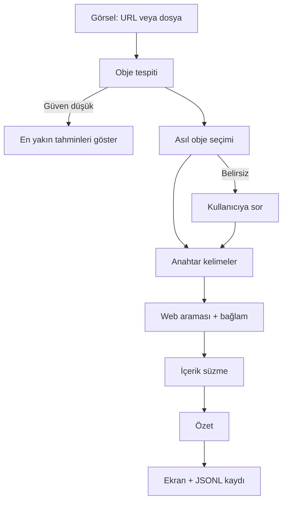

# Görselden Özete

Bir görseldeki asıl objeyi tespit eden, o obje hakkında web'de araştırma yapan ve kaynaklardan seçilmiş cümlelerle kısa bir özet sunan komut satırı uygulaması.

Kullanıcı bir görsel URL'si ya da dosya yolu verir. Uygulama asıl objeyi bulur (ör. `backpack`), 3 anahtar kelime üretir, web'de arar, güvenilir sayfaları süzer ve özeti gösterir. Arka arkaya verilen görseller aynı sohbetin parçası gibi ele alınır.

## Özellikler

- **Açık sözlüklü obje tespiti:** YOLOE-26 modeli, LVIS'in 1205 sınıfıyla ek eğitim gerekmeden çalışır.
- **Asıl obje seçimi:** Objeler alan ve güven skoruna göre sıralanır; masa gibi yüzeyler ve tabak gibi kaplar geri plana düşürülür. Karar net değilse kullanıcıya sorulur.
- **Anlamsal anahtar kelime:** MobileCLIP2 ile obje adı 1057 kelimelik bir havuzla karşılaştırılır, en yakın 3 kelime seçilir.
- **Konuşma bağlamı:** Son 3 obje hatırlanır ve yeni aramalara bağlam olarak eklenir (ör. köpekten sonra gelen frizbi, "köpekler için frizbi" olarak aranır).
- **Süzülmüş web araştırması:** Kısa, sözlük, ticari ve konu dışı sayfalar elenir.
- **Çıkarımsal özet:** Özet kaynak metinden seçilen cümlelerden oluşur, yeniden yazılmaz.

## Nasıl Çalışır?



1. Görsel okunur ve objeler tespit edilir. Hiçbir tahmin %50 güveni geçmezse en yakın 3 tahmin gösterilir.
2. Asıl obje seçilir; birden fazla aday birbirine çok yakınsa kullanıcıya hangisi olduğu sorulur.
3. Obje için 3 anahtar kelime üretilir ve önceki objelerden gelen bağlam terimleri eklenir.
4. Web'de arama yapılır, sayfalar indirilip süzülür. Yeterli içerik yoksa ek arama yapılır.
5. En alakalı 5 cümle seçilir, tekrarlar elenir ve özet ekrana basılır.

## Kurulum

Python 3.11 veya üzeri gerekir. Model ağırlıkları ilk çalıştırmada otomatik iner (~330 MB).

```bash
git clone https://github.com/tuncayorgundar/Gorselden_Ozete.git
cd Gorselden_Ozete/Goruntlu_Sohbet_Uygulamasi
pip install -r requirements.txt
```

## Kullanım

```bash
python main.py
```

Görsel URL'si veya dosya yolu girin. Çıkmak için `q`, `quit` ya da `exit` yazın.

```text
Image source (URL or file path): backpack.jpg

  → Detecting objects
  ✔ Detected: backpack
  ✔ Keywords: bag, luggage, hiking gear
  → Searching the web
  → Summarizing

Detected Object: backpack (91% confidence)
Keywords: bag, luggage, hiking gear
Summary: ...
```

Birden fazla belirgin obje varsa seçim istenir:

```text
Multiple prominent objects were detected in the image:
  [1] dog (score: 0.52)
  [2] frisbee (score: 0.48)
Which one would you like to inspect? [1]:
```

## Proje Yapısı

```text
Goruntlu_Sohbet_Uygulamasi/
├── main.py                 # Bileşenleri kurar ve pipeline'a verir
├── cli.py                  # Komut satırı arayüzü ve rapor çıktısı
├── pipeline.py             # Uçtan uca akış
├── conversation_context.py # Son 3 objeyi hatırlayan bağlam
├── vision/                 # Görsel okuma, obje tespiti, asıl obje skoru
├── keywords/               # MobileCLIP2 ile anahtar kelime üretimi
├── web_search/             # DDGS ile web araması
├── content/                # İçerik süzme ve özetleme
├── repository/             # Sonuçları JSONL'e kaydetme
└── data/                   # LVIS sınıfları ve model dosyaları
```

## Yöntem

**Obje tespiti:** YOLOE, sınıf listesini çalışma zamanında metinle tanımlamaya izin verir. Bu sayede LVIS'in 1205 sınıfı eğitim yapmadan kullanılır. LVIS, COCO'nun 80 sınıfına göre çok daha geniş bir çeşitlilik sunduğu için seçildi.

**Asıl obje skoru:**

```text
skor = 0.7 × √(alan oranı) + 0.3 × güven
```

Taşıyıcı yüzey veya kap olan objelerin skoru 0,45 ile çarpılır. En yüksek skor 0,55'in altındaysa ya da ilk iki aday arasındaki fark 0,08'den azsa kullanıcıya seçim sunulur.

**Arama ve süzme:** DDGS ile obje adı, anahtar kelimeler ve bağlam terimleriyle arama yapılır. Sayfaların ana metni `trafilatura` ile çıkarılır; en az 200 kelime içermeyen, obje adı geçmeyen, ticari kalıp içeren veya konu yoğunluğu düşük sayfalar elenir. Hiç ansiklopedik kaynak (Wikipedia, .edu, .gov) bulunamazsa ek bir tanım araması yapılır.

**Özetleme:** Cümleler Luhn yöntemine dayanan bir formülle puanlanır:

```text
skor = 0.35 × frekans + 0.2 × pozisyon + 0.3 × uzunluk − 0.15 × gezinme cezası + 0.05 × bağlam bonusu
```

Birbirine %60'tan fazla benzeyen cümleler elenir ve seçilenler kaynaktaki sırasıyla birleştirilir.

## Lisans

Bu proje [MIT Lisansı](LICENSE) ile lisanslanmıştır.

**Tuncay Bayır** · [GitHub](https://github.com/tuncayorgundar) · [Kaggle](https://www.kaggle.com/tuncayorgundar)
